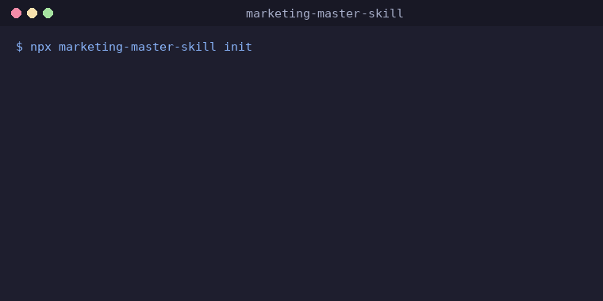

# marketing-master-skill

Two AI agent skills for `SKILL.md`-compatible agents such as Claude Code, installed with one command.

1. **`marketing-master`** — a token-optimized marketing orchestrator built on five frameworks: Kotler, Godin, Ogilvy, GaryVee, and Neil Patel. It runs a mandatory research gate, loads one persona at a time, and blocks its own copy with a deterministic Python anti-slop linter.
2. **`natural-food-photographer`** — a food photography director that turns a dish name or a raw phone photo into a clean, appetizing, realistic photo, and refuses the glossy AI-slop look. Built for GoFood/GrabFood/ShopeeFood menu shots and for promo banners.



## Install

Install both skills into the current project (`.claude/skills/`):

```bash
npx marketing-master-skill init
```

Install into your user directory (`~/.claude/skills/`) so they are available in every project:

```bash
npx marketing-master-skill init --global
```

Install only one of them:

```bash
npx marketing-master-skill init marketing-master
npx marketing-master-skill init natural-food-photographer --global
```

List the skills the package ships:

```bash
npx marketing-master-skill list
```

## marketing-master

How a run works:

1. **Phase 0, research gate.** Reads `docs/marketing/00-research-brief.md` if it exists. Otherwise it scans high-signal files (`README.md`, manifests) and compresses the facts into that brief, hard-capped at 600 words.
2. **Lazy persona loading.** Loads the one persona the task needs, plus the gold examples. Never the whole set.
3. **Artifact handoff.** Each stage writes a numbered file under `docs/marketing/` (`01-stp-offer.md` through `05-seo-funnel.md`) so the next stage reads a file instead of re-scanning the repo.
4. **Linter gate.** Any copy artifact is checked by `scripts/lint_copy.py`, which flags banned slop words (`unlock`, `seamless`, `elevate`, `leverage`, and friends), more than 6 em-dashes, and sentences over 28 words. Exit code 1 means the draft needs another pass.

| Task | Persona | Output |
| :--- | :--- | :--- |
| GTM, pricing, ICP | Kotler | `01-stp-offer.md` |
| Positioning, differentiation | Godin | `02-positioning.md` |
| Landing page, ads, core copy | Ogilvy | `03-core-copy.md` |
| X threads, LinkedIn, short-form | GaryVee | `04-social-content.md` |
| SEO, blog, lead magnet | Neil Patel | `05-seo-funnel.md` |

## natural-food-photographer

Asks one question up front: online menu photo, or promo banner. That choice sets two presets.

- **Preset A, online menu:** pure photo, zero text, 1:1 or 4:3 framing so nothing gets cropped in the app.
- **Preset B, promo banner:** clean negative space and legible type are allowed, effects stay natural.

It also runs the **Physical Translation Protocol**: a local dish name is deconstructed into visible ingredients, micro-textures, and real moisture levels before any image is generated, so the result looks like the dish rather than a stock photo of a category.

Banned prompt words include `8k`, `ultra-detailed`, `hyper-realistic`, `HDR`, `cinematic`, `glowing`, `vibrant`, `mouth-watering`, `masterpiece`. If you ask for them anyway, the skill strips the buzzwords and translates the intent into natural food cues instead of obeying.

## Usage in Claude Code

```
"Use marketing-master to run the full GTM pipeline for this repo"
"Use marketing-master to write a launch X thread based on our README"
"Use natural-food-photographer for a GoFood menu photo of nasi goreng"
"Use natural-food-photographer to turn this phone photo into a banner"
```

## Repo layout

```
bin/cli.js                                  installer
skills/marketing-master/SKILL.md            orchestrator
skills/marketing-master/personas/           five frameworks, loaded one at a time
skills/marketing-master/references/         gold examples
skills/marketing-master/scripts/lint_copy.py anti-slop linter
skills/natural-food-photographer/SKILL.md   food photography director
examples/03-core-copy-example.md            copy that passes the linter
demo.tape                                   VHS recording of the demo gif
```

## Run the linter directly

```bash
python3 .claude/skills/marketing-master/scripts/lint_copy.py examples/03-core-copy-example.md
```

## License

MIT
